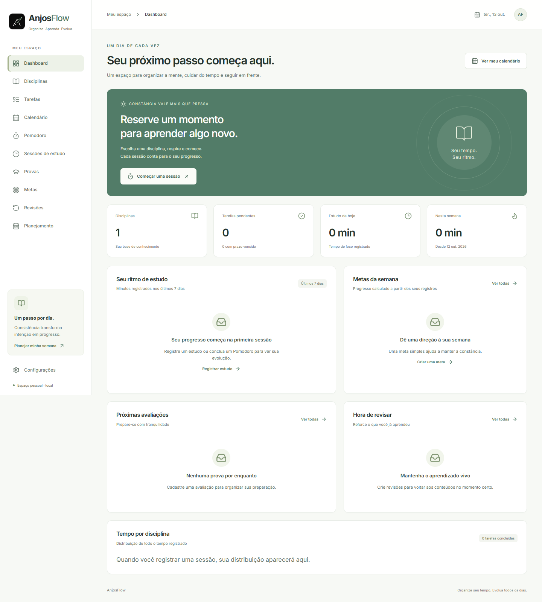

# AnjosFlow


**Organize seu tempo. Evolua todos os dias.**

MVP Full Stack de organização de estudos para universitários e concurseiros.
Centraliza disciplinas, tarefas, calendário, tempo estudado, avaliações, metas,
revisões e planejamento semanal em uma interface branca e verde sálvia.
Projeto de portfólio com foco em Back-end Java, regras testáveis e persistência real.

**Escopo:** aplicação local, pessoal, de usuário único, sem autenticação.
Autenticação e implantação pública não fazem parte deste MVP.

## Funcionalidades implementadas

- CRUD de disciplinas preservado, com cores e auditoria.
- Tarefas com prioridade, prazo, estimativa, filtros, conclusão e reabertura.
- Calendário mensal, semanal e diário, com eventos reais e provas projetadas.
- Sessões manuais e sessões de foco, histórico, filtros e idempotência.
- Pomodoro com durações configuráveis, pausas, retomada e recuperação após reload.
- Provas com status, local, nota e pontuação máxima validados.
- Metas semanais de minutos estudados ou tarefas concluídas, com progresso real.
- Revisões de 1, 3, 7, 14 e 30 dias; continuidade em 30 dias.
- Dashboard agregado no PostgreSQL, gráfico diário e distribuição por disciplina.
- Disponibilidade semanal persistida e planejador determinístico com preview/aceite.
- Preferências de nome e Pomodoro locais ao navegador.
- Formulários, confirmação de exclusão, feedback, estados vazios/erro/loading,
  navegação por teclado e layout responsivo.

Não existem dados fictícios na aplicação. Mocks são usados apenas nos testes.

## Capturas reais



[Dashboard no celular](docs/screenshots/dashboard-mobile.png).
As capturas usam a API e o PostgreSQL locais; estados vazios refletem ausência
real de registros de produtividade. A logo original foi copiada sem redesenho.

## Tecnologias

Back-end: Java 21, Spring Boot 3.5.16, Spring Web, JPA, Bean Validation, PostgreSQL 17,
Flyway, Maven 3.9.11 via Wrapper, JUnit 5 e Mockito.

Front-end: React, TypeScript, Vite, Tailwind CSS 4, React Router, Lucide,
FullCalendar 6 com Luxon para fusos, Recharts e fonte Inter hospedada localmente.
Testes: Vitest, Testing Library e Playwright no Microsoft Edge.
`frontend/package-lock.json` fixa as versões instaladas.

## Estrutura

```text
backend/
  src/main/java/com/anjosflow/
    subject/ task/ calendar/ study/ exam/ goal/ review/ dashboard/ schedule/
    common/ config/
  src/main/resources/db/migration/   V1–V10
  src/test/java/com/anjosflow/
  mvnw, mvnw.cmd, .mvn/wrapper/
frontend/
  src/app/ components/ features/ hooks/ pages/ services/ styles/ types/ test/
  public/anjosflow-logo.png
  e2e/
docs/                              arquitetura, API, regras, testes e screenshots
assets/
compose.yaml
.env.example
README.md
```

## Executar no Windows PowerShell

Pré-requisitos: JDK 21, Docker Desktop com Compose v2, Node.js 22.12+ ou 24 e npm.
Maven não precisa ser instalado globalmente. Edge é usado pelos testes E2E.

Na raiz do projeto, preserve o `.env` existente:

```powershell
if (-not (Test-Path .env)) { Copy-Item .env.example .env }
# Apenas em uma configuração nova: editar .env e definir POSTGRES_PASSWORD.
docker compose up -d --wait
docker compose ps
```

Use valores KEY=value simples, sem aspas. O Spring importa o `.env` da raiz;
variáveis do processo têm precedência. As credenciais ficam apenas nesse arquivo
ignorado pelo Git. Não copie o `.env` do banco para o Front-end.

Terminal 1, Back-end:

```powershell
cd backend
.\mvnw.cmd spring-boot:run
```

Se uma API antiga ocupar 8080, encerre-a **manualmente no terminal original** antes
de iniciar a nova versão. Não substitua nem encerre outros processos à força.

Terminal 2, a partir da raiz:

```powershell
cd frontend
npm.cmd ci
npm.cmd run dev
```

Abra **http://localhost:5173**. API: http://localhost:8080.
O Vite usa porta fixa e falha explicitamente se ela estiver ocupada. A API e o
Vite ficam vinculados a loopback; PostgreSQL também permanece local.
CORS aceita apenas a origem configurada e seu equivalente 127.0.0.1.

Configuração opcional do Front-end:

```powershell
# Dentro de frontend, apenas se o arquivo ainda não existir:
if (-not (Test-Path .env)) { Copy-Item .env.example .env }
```

`VITE_API_URL=http://localhost:8080` é o padrão. Variáveis VITE são públicas;
nenhuma senha deve entrar nesse arquivo. Reinicie o Vite após alterar a URL.

Verificar saúde em outro terminal:

```powershell
curl.exe -i http://localhost:8080/api/health
```

Flyway aplica novas migrations automaticamente; Hibernate apenas valida o schema.
Exclusões com vínculos retornam 409, sem apagar dados em cascata.

## Testes e builds

Back-end, de backend:

```powershell
.\mvnw.cmd test
.\mvnw.cmd verify -Pintegration
```

O segundo comando exige PostgreSQL. Testes HTTP usam portas aleatórias.
Testes removem somente seus próprios IDs; testes do planejador fazem rollback.

Front-end, de frontend:

```powershell
npm.cmd test
npm.cmd run typecheck
npm.cmd run build
```

E2E, com API e Vite iniciados e Edge instalado:

```powershell
npm.cmd run test:e2e
```

Os testes E2E criam registros identificados como E2E e removem apenas esses
registros. Não substituem a disponibilidade do usuário. URLs alternativas:

```powershell
$env:E2E_BASE_URL='http://localhost:5174'
$env:E2E_API_URL='http://localhost:8081'
npm.cmd run test:e2e
```

Para gerar o JAR, use `verify` ou `package`. Antes de empacotar no Windows,
encerre a sua execução de `java -jar target/...jar`: o JAR em uso fica bloqueado.
Execução pela raiz: `java -jar backend/target/anjosflow-backend-0.1.0-SNAPSHOT.jar`.
Build web em `frontend/dist`; `npm.cmd run preview` o serve localmente.
Resultados exatos e verificações realizadas estão em [validação](docs/validation.md).

## Documentação

- [Arquitetura](docs/architecture.md) e [modelo de dados](docs/data-model.md).
- [Endpoints e exemplos](docs/api.md).
- [Regras, períodos e Pomodoro](docs/business-rules.md).
- [Algoritmo do planejador](docs/planner.md).
- [Contrato original de disciplinas](docs/subjects.md).
- [Estado final e próximos passos](docs/progress.md).

## Limitações e evolução

Sem autenticação, contas, sincronização entre dispositivos ou implantação pública.
Preferências e estado do cronômetro pertencem ao navegador; dados de estudo são
persistidos no PostgreSQL. Não há alarmes garantidos com o navegador fechado.
Sessões são imutáveis; é possível excluir um registro incorreto e registrar outro.
O calendário permite eventos manuais sobrepostos; o planejador evita conflitos.
Provas ocupam uma hora no calendário/planejador, pois o MVP não cadastra duração.
Listagens ainda não possuem paginação. O algoritmo sugere tarefas pendentes;
não inventa conteúdo de disciplinas sem tarefas. Não utiliza IA externa.

Próximas melhorias: autenticação/autorização antes de publicar, paginação,
exportação/backup, histórico detalhado de cada revisão, duração configurável das
provas, preferências sincronizadas e otimização de carga com grandes históricos.

Nenhum commit, push, publicação, volume apagado ou limpeza do banco foi realizado
na implementação deste MVP.
## Versão pública de portfólio

- Código: https://github.com/horaanjos/AnjosFlow
- Apresentação: https://anjosflow-horaanjos.netlify.app

A Netlify publica apenas o Front-end em modo de portfólio. API e banco continuam
locais; gravações são desabilitadas na apresentação, e capturas são identificadas.
Pomodoro e preferências funcionam no navegador. Veja docs/deployment.md.
