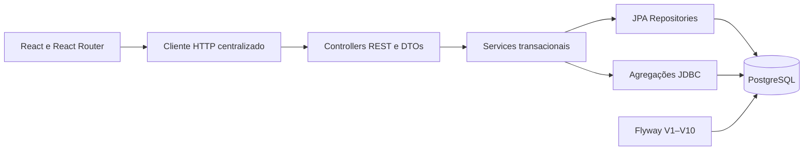

# Arquitetura do AnjosFlow

## Estrutura geral

Monorepo local com um monólito modular Java e uma SPA React. A base Spring Boot
3.5.16, Maven Wrapper, endpoint de saúde e contrato de disciplinas foram mantidos.
Não há microsserviços, autenticação improvisada ou infraestrutura de implantação.

## Domínios

subject, task, calendar, study, exam, goal, review, schedule e dashboard. Cada
recurso persistido tem entidade, Repository, Request/Response DTO, Service e
Controller. Controllers validam a fronteira HTTP; Services executam regras e
controlam transações. Entidades não são serializadas como resposta da API.

Referências são IDs tipados e validados no Service, com chaves estrangeiras reais
no PostgreSQL. Essa opção mantém DTOs simples e evita carregamento lazy/N+1.
Não há cascatas de exclusão. Auditoria dos novos domínios é reutilizada por
AuditedEntity; a entidade Subject existente foi preservada sem migração de código.

AppTime centraliza o fuso America/Sao_Paulo e recebe Clock para testar períodos.
HealthService consulta SELECT 1. DashboardService usa agregações parametrizadas
no PostgreSQL, com séries diárias e intervalos explícitos. StudyGoalService calcula
valores de todas as metas em uma consulta agregada, sem ida ao banco por meta.

StudySessionService usa clientKey e advisory lock transacional para idempotência.
CalendarService projeta provas diretamente na agenda, evitando duplicação de
estado entre duas tabelas. ReviewService contém a sequência simples de intervalos.
PlannerEngine é uma função de dados de entrada, sem dependências de persistência;
PlanningService materializa dados, verifica conflitos e grava somente o aceite.

GlobalExceptionHandler conserva o tratamento anterior e acrescenta ApiException
(400/404/409), conflitos de integridade e validações. As respostas não incluem
SQL ou stack trace. ValidationMessages.properties centraliza mensagens em pt-BR.

## Front-end

App organiza layout e rotas. ResourcePage/ResourceForm compartilham listagem,
formulários, edição, confirmação e feedback; config declara campos por recurso.
Componentes próprios implementam Dashboard, Calendário, Pomodoro, Planejamento
e Configurações. DTOs são interfaces em types/api.ts. O cliente HTTP centraliza
URL, JSON e erros; useApi controla cancelamento, carregamento e atualização.

FullCalendar oferece mês/semana/dia com plugin Luxon em São Paulo. Inputs locais
são convertidos para UTC em services/dates.ts. Recharts recebe agregados reais.
Calendário e dashboard são importados por rota. Inter é servida localmente.
Tokens visuais e CSS responsivo ficam em styles/main.css, integrado ao Tailwind 4.
A logo PNG é uma cópia fiel do arquivo fornecido, sem vetorização aproximada.

Preferências e cronômetro ficam no navegador. Conteúdo de estudo e disponibilidade
ficam no PostgreSQL. Estado do cronômetro usa deadline absoluto e chave persistida
do ciclo; não usa contagem de setInterval como fonte de tempo.

## Infraestrutura e qualidade

API e Vite escutam em loopback. CORS aceita a origem configurada e o equivalente
127.0.0.1 da mesma porta. Credenciais são importadas do .env da raiz, ignorado pelo
Git; nenhuma configuração do banco foi sobrescrita. Flyway evolui o schema e JPA
apenas valida. V1/V2 permaneceram intactas; a evolução usa V3–V10.

Testes unitários isolam regras e HTTP com Mockito/MockMvc. Integração usa PostgreSQL
real e portas aleatórias. Testes do planejador fazem rollback e outros removem
somente os IDs criados por eles. Front-end usa Vitest/Testing Library; Playwright
verifica formulários reais, calendário, responsividade e foco salvo na API.

## Exercício de aprendizado

Leia TaskService.transition e acompanhe o teste de completar/reabrir. Depois leia
PlannerEngine.generate e explique por que ele não salva registros. Identifique a
linha de PlanningService.accept que revalida o fingerprint antes de persistir.