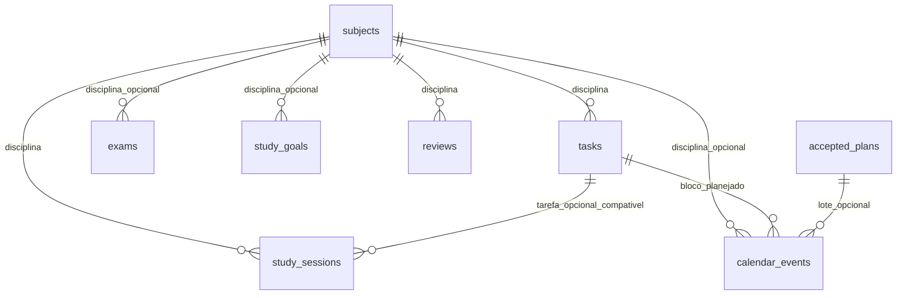

# Modelo de dados

Todas as tabelas de domínio têm chave BIGINT gerada automaticamente e auditoria
created_at/updated_at gerenciada pelo servidor. Datas civis usam DATE, horários
usam TIMESTAMPTZ e disponibilidade usa TIME. Não há tabela de usuário neste MVP.

study_availability guarda janelas recorrentes, sem depender de registros de
usuário. accepted_plans guarda chave de idempotência, fingerprint e criação.
application_metadata e flyway_schema_history permanecem como tabelas técnicas.

## Migrations

| Versão | Alteração |
|---|---|
| V1 | Metadados da aplicação (preservada) |
| V2 | Disciplinas (preservada) |
| V3 | Tarefas, enums, conclusão e índices |
| V4 | Eventos, período e referências |
| V5 | Sessões e chave única de idempotência |
| V6 | Provas e constraints de nota |
| V7 | Metas semanais positivas |
| V8 | Revisões e intervalos permitidos |
| V9 | Disponibilidade, lotes aceitos e vínculos de eventos |
| V10 | FK composta sessão/tarefa/disciplina |

Chaves estrangeiras têm RESTRICT. Não existe remoção em cascata de dados de
estudo ao excluir disciplinas ou tarefas. Índices cobrem filtros por disciplina,
status, prazo, término, agendamento e próxima revisão. V10 mantém compatibilidade
entre tarefa e sessão inclusive após futuras tentativas de editar a tarefa.

O Hibernate permanece ddl-auto=validate. Não edite migrations aplicadas; futuras
mudanças devem usar V11 em diante. Não remova volumes nem limpe schemas de produção
ou desenvolvimento para corrigir uma migration.